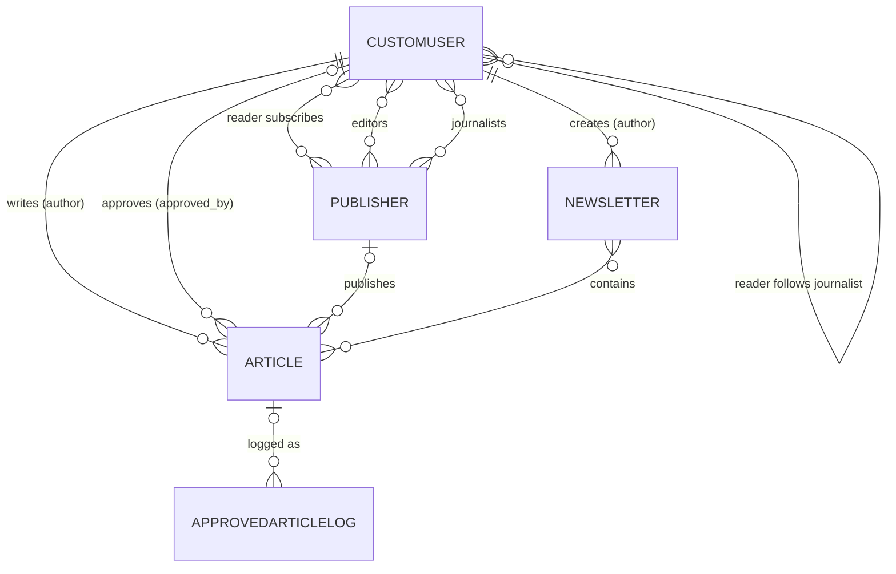

# The Newsroom – design document

This document is the plan the application was built from: requirements,
roles, database design (normalised), front-end planning, URL map and the
approval workflow.

## 1. Purpose

A news application where **readers** view articles published by
**publishers** and **independent journalists**. Journalists write articles
and newsletters, **editors** review and approve articles, and third-party
API clients can retrieve the articles a reader has subscribed to.

## 2. Requirements

### 2.1 Functional requirements (what the program must *do*)

| ID | Requirement |
|----|-------------|
| FR-1 | Users register, log in and log out. Self-registration offers the Reader, Journalist and Editor roles, so no admin panel is needed. |
| FR-2 | Every user has one role (Reader, Editor, Journalist) and is automatically placed in the group of the same name. |
| FR-3 | Journalists create articles, either independently or for a publisher they work for. New articles start **unapproved**. |
| FR-4 | Editors see a review queue of unapproved articles, and can approve, edit or delete them. |
| FR-5 | Only approved articles are visible to readers (lists, detail pages and API). |
| FR-6 | When an article is approved, subscribers of its journalist or publisher are e-mailed, and the article is POSTed to our own endpoint `/api/approved/`. |
| FR-7 | Readers subscribe to publishers and journalists and can filter the article list to their subscriptions. |
| FR-8 | Journalists create newsletters (curated collections of approved articles). Readers view them; journalists (own) and editors edit/delete them. |
| FR-9 | A publisher has many editors and many journalists. Editors create publishers on the site (becoming one of its editors) and tick the editors and journalists who belong to it. |
| FR-10 | Reader-only fields (subscriptions) are empty for journalists/editors; journalist-only fields (own articles/newsletters) are `None` for readers. |
| FR-11 | REST API: list approved articles, list subscribed articles, retrieve, create, update, delete, plus token authentication. |
| FR-12 | API authorisation by role: journalists POST, editors approve, readers only view. |
| FR-13 | DRF serializers exist for Article, User, Newsletter and Publisher. |
| FR-14 | Automated unit tests cover the API, roles, newsletters and the approval logic. |

### 2.2 Non-functional requirements (characteristics of the system)

| ID | Requirement | How it is met |
|----|-------------|---------------|
| NFR-1 Security | Least privilege; staff/superuser status can never be self-assigned; CSRF protection; hashed passwords; secrets from environment. | Role groups with model permissions; `RegistrationForm` only offers the three site roles and never sets `is_staff`/`is_superuser`; Django CSRF; `DJANGO_SECRET_KEY` and `APPROVED_API_TOKEN` env vars; internal endpoint requires a shared token compared in constant time. |
| NFR-2 Data integrity | Normalised tables; invalid combinations rejected. | 3NF schema (section 4); `Article.clean()` checks author role and publisher membership. |
| NFR-3 Reliability | A mail or network outage must not block an editor's approval. | `services.py` catches `SMTPException`, `OSError` and `requests.RequestException`, logs and carries on. |
| NFR-4 Performance | No N+1 queries on list pages; each request does little work. | `select_related` on article queries; indexed `(approved, -created_at)`; pagination on list pages. |
| NFR-5 Maintainability | PEP 8, docstrings, small functions, separation of concerns. | `models`, `queries`, `services`, `signals`, `permissions`, `views`, `api_views` each have one job. Checked with flake8. |
| NFR-6 Usability / accessibility | Clear navigation, responsive layout, keyboard and screen-reader friendly. | Skip link, visible focus rings, semantic landmarks, labelled forms, colour is never the only status cue, mobile layout. |
| NFR-7 Testability | Side effects can be tested without a network or mail server. | Network and mail calls sit behind `services.py`; tests mock `requests.post` and use Django's in-memory mail outbox. |
| NFR-8 Portability | Runs out of the box; swappable database. | MariaDB via environment-variable settings; `DB_ENGINE=sqlite` for quick local runs. |

## 3. Roles and permissions

| Capability | Reader | Journalist | Editor |
|---|:-:|:-:|:-:|
| View approved articles and newsletters | yes | yes | yes |
| View unapproved articles | no | own only | all |
| Create articles / newsletters | no | yes | no |
| Update / delete articles and newsletters | no | own only | all |
| Approve articles | no | no | yes |
| Create / edit / delete publishers | no | no | yes (edit/delete: editors of that publisher) |
| Manage subscriptions | yes | – | – |

Implemented as three Django `Group`s (Reader, Editor, Journalist) created
after every `migrate` by `news/groups.py`. `approve_article` is a custom
model permission on `Article`. Views use `PermissionRequiredMixin`; the
"own content only" rule is an object-level check (`can_manage`).

## 4. Database design

### 4.1 Entities

* **CustomUser** – `id`, `username`, `email`, `password`, … (from
  `AbstractUser`), `role`.
* **Publisher** – `id`, `name` (unique), `description`.
* **Article** – `id`, `title`, `content`, `author_id` → CustomUser,
  `publisher_id` → Publisher (nullable), `created_at`, `approved`,
  `approved_by_id` → CustomUser (nullable).
* **Newsletter** – `id`, `title`, `description`, `created_at`,
  `author_id` → CustomUser.
* **ApprovedArticleLog** – `id`, `article_id` → Article (nullable),
  `title`, `payload` (JSON), `received_at`. Receipts from `/api/approved/`.
* Link tables (one row per pair, created by Django `ManyToManyField`s):
  `Publisher_editors`, `Publisher_journalists`,
  `CustomUser_subscribed_publishers`, `CustomUser_subscribed_journalists`,
  `Newsletter_articles`.

### 4.2 ERD



### 4.3 Normalisation

* **1NF** – every column holds one atomic value; lists (editors,
  journalists, subscriptions, newsletter contents) are link tables, never
  comma-separated columns.
* **2NF** – every table has a single-column surrogate key, so no partial
  dependencies are possible.
* **3NF** – non-key columns depend only on the key. The publisher's *name*
  is stored once in `Publisher`, not copied onto each article. A user's
  group is derived from `role` rather than stored twice.
* **"Independent" articles** are not a separate table or flag: an article
  with `publisher IS NULL` is independent. This satisfies "associated with a
  journalist *or* a publisher" without duplicating information.
* **Role-specific fields.** Reader subscriptions are real M2M columns on the
  user. Journalist content uses reverse relations (`user.articles`,
  `user.newsletters`); `independent_articles` and `independent_newsletters`
  return `None` for non-journalists, and subscriptions are emptied for
  non-readers (on save, and on later M2M changes via `m2m_changed`).
* **Deletion rules** – deleting a user deletes their articles and
  newsletters; `approved_by`, log rows and `Article.publisher` use `SET_NULL`,
  so deleting a publisher keeps its articles (they become independent).

## 5. Front-end (UI/UX) plan

### 5.1 Principles

Readable newspaper feel (serif body text, sans-serif controls), one column,
strong contrast, large click targets, the same card pattern everywhere,
flash messages for every action, and navigation that only shows what the
current role may use.

### 5.2 Site map

```
Log in / Sign up
└── Articles (home)  ── All | My subscriptions (readers)
     ├── Article detail ── Edit / Delete (owner journalist, editors)
     ├── Write article (journalists)
     ├── My articles (journalists, with approval status)
     ├── Publishers (editors) ── New / Edit staff / Delete
     ├── Review queue (editors) ── Approve & publish / Edit / Reject
     ├── Newsletters ── detail ── Edit / Delete
     │       └── New newsletter (journalists)
     └── Subscriptions (readers)
```

### 5.3 Wireframes

```
Articles (reader)                      Review queue (editor)
+------------------------------+       +--------------------------------+
| The Newsroom  Articles  ...  |       | The Newsroom ... Review queue  |
+------------------------------+       +--------------------------------+
| Latest articles              |       | Review queue                   |
| [All] [My subscriptions]     |       | +----------------------------+ |
| +--------------------------+ |       | | Title                      | |
| | Headline (link)          | |       | | By jane · Daily Planet     | |
| | By jane · Independent    | |       | | > Read the full text       | |
| | 12 Oct 2026              | |       | | [Approve & publish] [Edit] | |
| | First 35 words ...       | |       | |                  [Reject]  | |
| +--------------------------+ |       | +----------------------------+ |
| Newer        Page 1/3  Older |       +--------------------------------+
+------------------------------+
```

Forms (sign-up, article, newsletter, subscriptions) share one template with
a heading, labelled fields, inline errors and a primary action.

## 6. Routes

### 6.1 Web

| URL | View | Who |
|-----|------|-----|
| `/` | article list | any logged-in user |
| `/register/`, `/accounts/login/`, `/accounts/logout/` | accounts | anyone |
| `/subscriptions/` | subscriptions | readers |
| `/articles/new/` | create article | journalists |
| `/articles/mine/` | my articles | journalists |
| `/articles/<id>/`, `/edit/`, `/delete/` | detail / update / delete | see section 3 |
| `/publishers/`, `/publishers/new/`, `/publishers/<id>/edit/`, `/delete/` | manage publishers and their staff | editors |
| `/review/` | review queue | editors |
| `/review/<id>/approve/` (POST) | approve article | editors |
| `/newsletters/`, `/new/`, `/<id>/`, `/edit/`, `/delete/` | newsletters | see section 3 |

### 6.2 REST API (`/api/`, token authentication)

| Method & URL | Purpose | Who |
|---|---|---|
| `POST /api/token/` (alias `/api/login/`) | obtain token | anyone with credentials |
| `GET /api/articles/` | all approved articles | any authenticated user |
| `GET /api/articles/subscribed/` | approved articles from the reader's subscriptions | any authenticated user (empty for non-readers) |
| `GET /api/articles/<id>/` | one article (unapproved: editors/author only) | any authenticated user |
| `POST /api/articles/` | create | journalists |
| `PUT/PATCH /api/articles/<id>/` | update; `approved` may only be changed by editors | editors, owner journalist |
| `DELETE /api/articles/<id>/` | delete | editors, owner journalist |
| `/api/newsletters/…` | same pattern for newsletters | read: all; write: see section 3 |
| `GET /api/publishers/` | publishers (read-only) | any authenticated user |
| `GET /api/users/me/` | the caller's profile | any authenticated user |
| `POST /api/approved/` | receives approved articles (internal, shared-token header) | our own server |

## 7. Approval workflow (implementation strategy: Option 1 – signals)

```
Editor approves (web button or API PUT/PATCH approved=true)
        │  article.save()
        ▼
pre_save  → remember whether the article was already approved
post_save → if approved now and not before:
              1. services.send_approval_email()   → e-mail subscribers (BCC)
              2. services.post_approved_article() → POST /api/approved/
```

* Re-saving an already-approved article does nothing (no duplicate e-mails).
* Failures are logged and swallowed (NFR-3).
* `/api/approved/` validates the payload, checks the shared token and stores
  an `ApprovedArticleLog` row, simulating sharing with an external system
  while keeping the integration inside the project.

## 8. Testing strategy

`news/tests/` uses Django's test framework (`python manage.py test`):

* `test_models.py` – groups and permissions, role-specific fields,
  validation.
* `test_signals.py` – who is e-mailed, exactly-once behaviour, payload,
  failure handling (`requests.post` mocked, in-memory mail outbox).
* `test_views.py` – access control per role, review queue, forms,
  newsletters, subscriptions, registration.
* `test_api.py` – tokens, per-role access, subscriptions, CRUD, newsletters,
  the approved endpoint; both successful and failing requests.
